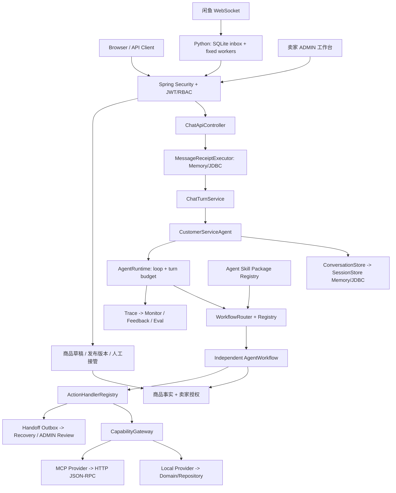

# Smart CS Agent｜闲鱼卖家智能客服

面向闲鱼个人卖家的 Java 客服 Agent，支持当前二手商品咨询、受卖家授权约束的多轮议价、交易安排答复、卖家核实与人工接管。Python 侧车承接平台协议，Java 后端负责业务流程、身份权限和回复生成。

仓库已有闲鱼真机消息收发记录；2026-10-07 的主线改造完成本地回归，尚未部署或重新连接闲鱼验证。验证范围见 [改造记录](docs/闲鱼主线改造-2026-10-07.md)。

## 闲鱼主线能力

- **真实渠道接入与消息处理：** 逐条解析 WebSocket 同步包，先写 SQLite 收件箱再应答；固定数量的工作任务按会话串行处理，卖家指令独立处理。事件 ID 传递到 Java，重复请求回放已保存结果。
- **当前商品咨询与授权议价：** 精确读取当前商品资料和平台同步的价格、库存；卖家规则控制底价、让价与包邮口径，跨轮确认时复核现势事实和授权，商品售出后停止推进成交。
- **商品审核：** 平台描述只生成草稿，卖家在工作台核对标题、品类、型号、成色、配件和授权后发布；草稿修改期间继续使用原发布内容，版本冲突返回 409，发布即时生效。
- **交易安排与人工协作：** 按已发布授权回答发货安排、配件等问题；退货、保修或未核实承诺转卖家确认。暂停后停止自动回复，卖家人工消息同步会话历史，恢复需确认。
- **知识与事实分离：** 商品价格、库存和成色由事实服务提供；RAG 分别按渠道、品类、型号筛选资料。型号说明不能证明这件二手商品功能正常，未知信息进入澄清或核实流程。
- **卖家工作台：** `/#/admin/xianyu` 提供商品审核、授权编辑、指定买家/商品会话的暂停与恢复。浏览器使用经后端验证的 ADMIN JWT，服务令牌仅供侧车调用。

## 通用工程能力与商城演示

- Runtime、Workflow、Action Handler、Capability Gateway 分层，Spring 注册业务流程；闲鱼使用流程和能力白名单，新通用能力不会自动进入真实渠道。
- 会话状态支持 Memory/JDBC、CAS、跨轮恢复和摘要压缩；会话及用户偏好按租户和用户隔离。
- Capability 统一输入/输出契约，支持 Local/MCP Provider；副作用幂等、执行超时和结果未知有独立处理。人工工单 Outbox 提供有限恢复与 ADMIN 复核。
- 每轮限制 Action 数和总执行时间，LLM 调用使用有界线程池、超时和有限重试，失败可结构化降级。
- 知识检索支持关键词与可选 Embedding/Qdrant 混合召回、RRF 融合、规则重排及向量通道降级。
- Spring Security 校验 JWT 的签名、issuer、audience、时间、身份与租户，按 CUSTOMER、ADMIN、MCP_CLIENT 控制接口权限。
- Trace、Monitor、反馈审核、场景评测与 CI 支撑故障定位和回归；Docker/JAR 保持单体部署。
- 原订单查询、商城政策、退货申请等保留为通用工程与演示能力，闲鱼默认不开放这些流程。下文中的 ORD 示例和商城脚本属于该演示范围。

## 架构概览



核心设计取舍：

- Agent Skill Package 表达说明、Prompt、references 和能力 allowlist；Executable Workflow 负责任务状态机。
- `AgentRuntime` 只执行通用循环，Action Handler 执行动作，Capability Provider 提供原子业务能力。
- 高频明确场景优先用规则，表达模糊时再用 LLM 兜底。
- 当前输入、跨轮状态、本轮执行过程分别放在 `ChatRequest`、`ConversationState`、`TurnContext`。
- Local/MCP Provider 共用 Capability 契约，Workflow 不感知能力位于本地还是远程。
- Phase 9 已物理删除 Legacy Skill/Workflow Adapter、ToolManager、ToolRegistry 和重复 Tool Schema；运行时只有 Workflow/Capability 主链路。
- Phase 9.5 历史验收曾通过当时的 499 个默认测试、真实 MySQL、JAR、容器制品、订单/政策主链路和 readiness 掉线恢复；499 不是当前代码的最新测试数，验收后项目容器已停止。
- 当前有意保留单 Maven Module：一个 JAR、一个镜像、一个发布生命周期；用架构测试约束包边界，达到独立发布触发条件后再拆 Module。
- HTTP 身份只来自已验证 JWT Principal，不能由请求体、LLM 参数或 MCP `_meta` 覆盖。
- Session CAS、Capability 幂等和 Handoff Outbox 分别保护会话状态、副作用执行和外部结果未知，三者不能互相替代。
- Repository 默认使用内存模式，开启 JDBC 模式后通过 MyBatis/HikariCP 连接 MySQL，保证学习演示和真实持久化两种需求都能覆盖。
- 人工转接创建支持本地/售后 HTTP 双模式；售后结果查询使用独立三态 Port，当前默认明确 unavailable。
- RAG 默认 `local`，只使用本地字段加权关键词检索；`hybrid` 仅为故障排查增加 Embedding/Qdrant 通道，向量通道失败时关键词结果仍继续。旧值 `embedding-qdrant` 暂作为 `hybrid` 兼容别名。
- 先做稳定、可解释的规则评测，再补 LLM-as-Judge。

## 闲鱼接口与配置

| 接口 | 用途 | 身份 |
| --- | --- | --- |
| `POST /api/xianyu/sessions` | 买家身份注册、商品草稿与现势事实初始化 | 侧车服务令牌 |
| `POST /api/chat/send` | 买家消息；侧车传入稳定 `messageId` | 买家 JWT |
| `POST /api/xianyu/items/{itemId}/facts` | 平台价格、库存热更新 | 侧车服务令牌 |
| `POST /api/xianyu/conversations/seller-messages` | 卖家消息幂等写入历史 | 侧车服务令牌 |
| `GET /api/auth/me` | 验证工作台身份 | JWT |
| `GET /api/admin/xianyu/items` | 查看商品、草稿与发布资料 | 闲鱼租户 ADMIN JWT |
| `PUT /api/admin/xianyu/items/{itemId}/draft` | 保存草稿，携带 `expectedVersion` | 闲鱼租户 ADMIN JWT |
| `POST /api/admin/xianyu/items/{itemId}/publish` | 审核发布，携带 `expectedVersion` | 闲鱼租户 ADMIN JWT |
| `GET/POST /api/admin/xianyu/conversations/manual-mode` | 查询、暂停或恢复已建立的会话 | 闲鱼租户 ADMIN JWT |

侧车接入默认关闭，开启时设置 `SMARTCS_XIANYU_ENABLED=true`、私有 `SMARTCS_XIANYU_SERVICE_TOKEN`，与侧车 `CS_AGENT_TOKEN` 一致；JWT 签名密钥另行配置。真实接入使用 `SMARTCS_PERSISTENCE_MODE=jdbc`，保证 Java 消息回执与会话可跨重启保存。商品发布资料与现势覆盖保存在 `SMARTCS_XIANYU_ITEM_SNAPSHOT_DIR`，需挂载持久化目录。

当前支持单个配置卖家租户与单个 Java 实例。浏览器不签发凭据，也不持有侧车服务令牌；真实工作台需由身份系统签发该租户的 ADMIN JWT，在登录页验证后使用。侧车运行及结果未知的处理见 [侧车说明](sidecar/xianyu/README.md)。

## 主要接口

本地工作台先从 Demo-only 入口取得预置身份的短期 JWT：

```http
POST /api/auth/demo/tokens
```

响应带 `Cache-Control: no-store`。Demo 签发器默认关闭（该端点返回 404）；本地工作台需显式设置
`SMARTCS_SECURITY_DEMO_ISSUER_ENABLED=true` 与私有 JWT 密钥开启，生产由真实身份系统签发 JWT。
除首页、Demo 签发入口和健康探针外，下面的请求都需要：

```http
Authorization: Bearer <JWT>
```

主要角色边界：Chat/Memory 和反馈允许 CUSTOMER 或 ADMIN；Monitor 其余接口、Eval、Tool 和
`/api/admin/pending-handoffs/**` 只允许 ADMIN；`/api/mcp/**` 与 `/mcp` 允许 MCP_CLIENT 或 ADMIN。

发送聊天消息：

```http
POST /api/chat/send
Authorization: Bearer <CUSTOMER_JWT>
Content-Type: application/json

{
  "message": "我要退货",
  "conversationId": "demo-001"
}
```

空消息会返回结构化错误：

```json
{
  "errorCode": "VALIDATION_ERROR",
  "message": "Message cannot be empty",
  "timestamp": 1783350000000
}
```

接口层还提供了全局异常处理，JSON 解析失败、参数异常和未预期异常都会统一包装成 `ApiErrorResponse`。

查看当前会话记忆：

```http
GET /api/chat/conversations/{conversationId}/memory
Authorization: Bearer <CUSTOMER_JWT>
```

查看用户长期记忆：

```http
GET /api/chat/users/{userId}/memory
Authorization: Bearer <CUSTOMER_JWT>
```

清空当前会话记忆：

```http
DELETE /api/chat/conversations/{conversationId}/memory
```

清空用户长期记忆：

```http
DELETE /api/chat/users/{userId}/memory
```

查看已注册工具和输入/输出 schema：

```http
GET /api/tools
Authorization: Bearer <ADMIN_JWT>
```

查看 MCP Adapter 工具列表：

```http
GET /api/mcp/tools
Authorization: Bearer <MCP_CLIENT_JWT>
```

通过 MCP Adapter 调用工具：

```http
POST /api/mcp/tools/call
Authorization: Bearer <MCP_CLIENT_JWT>
Content-Type: application/json

{
  "name": "order.lookup",
  "arguments": {
    "order_id": "ORD-001"
  }
}
```

通过 JSON-RPC 风格 MCP Server 调用工具：

```http
POST /mcp
Authorization: Bearer <MCP_CLIENT_JWT>
Content-Type: application/json

{
  "jsonrpc": "2.0",
  "id": 1,
  "method": "tools/call",
  "params": {
    "name": "order.lookup",
    "arguments": {
      "order_id": "ORD-001"
    }
  }
}
```

查看需要人工复核的转接记录：

```http
GET /api/admin/pending-handoffs?status=NEEDS_MANUAL_REVIEW&size=20
Authorization: Bearer <ADMIN_JWT>
```

管理员可以读取详情和追加式审计，并使用下面四种处置命令：

```text
GET  /api/admin/pending-handoffs/{outboxId}
GET  /api/admin/pending-handoffs/{outboxId}/audit-events
POST /api/admin/pending-handoffs/{outboxId}/retry
POST /api/admin/pending-handoffs/{outboxId}/confirm
POST /api/admin/pending-handoffs/{outboxId}/reconcile
POST /api/admin/pending-handoffs/{outboxId}/close
```

写命令必须携带页面读取到的 `expectedVersion`、结构化原因和可选备注。tenantId、actorId、幂等键、
工单结果与证据来源都由服务端控制，不能通过请求体伪造。当前外部售后平台没有按 Idempotency-Key 的
只读查询接口，因此默认 `/reconcile` 返回 503；受信任管理员仍可在外部后台核对后使用 `/confirm`。

查看 Monitor 在线指标：

```http
GET /api/monitor/summary
Authorization: Bearer <ADMIN_JWT>
```

提交用户反馈：

```http
POST /api/monitor/feedback
Authorization: Bearer <CUSTOMER_JWT>
Content-Type: application/json

{
  "conversationId": "conv-USER-001-001",
  "rating": "HELPFUL",
  "reason": "前端快捷反馈：有用",
  "assistantReply": "您的订单已经发货"
}
```

查看由无用反馈生成的 Eval 候选样本：

```http
GET /api/monitor/feedback/candidates
```

审核 Eval 候选样本：

```http
POST /api/monitor/feedback/candidates/{candidateId}/review
Content-Type: application/json

{
  "status": "APPROVED",
  "reviewNote": "信息完整，可以进入回复质量评测"
}
```

导出审核通过的 Eval case 草稿：

```http
GET /api/monitor/feedback/candidates/export
```

人工补齐断言后，半自动合并到正式回复质量评测文件：

```http
POST /api/monitor/feedback/candidates/merge
Content-Type: application/json

{
  "cases": [
    {
      "sourceCandidateId": "EVAL-CAND-000001",
      "id": "feedback_eval_cand_000001",
      "candidateReply": "可以为您申请退货",
      "requiredKeywords": ["退货时效"],
      "forbiddenKeywords": ["Tool"],
      "expectedPass": false
    }
  ]
}
```

Eval 候选样本默认保存到本地文件：

```text
data/feedback-eval-candidates.json
```

这个路径可以通过环境变量覆盖：

```powershell
$env:SMARTCS_MONITOR_EVAL_CANDIDATES_FILE="data/feedback-eval-candidates.json"
```

`data/` 目录已经加入 `.gitignore`，避免把本地演示数据提交到仓库。

正式回复质量评测文件默认写入：

```text
src/test/resources/eval/response_quality_eval_cases.json
```

这个路径可以通过环境变量覆盖：

```powershell
$env:SMARTCS_MONITOR_RESPONSE_QUALITY_EVAL_FILE="src/test/resources/eval/response_quality_eval_cases.json"
```

查看最新评测报告和趋势：

```http
GET /api/eval/reports
```

查看服务健康状态：

```http
GET /api/health                       # 旧版兼容 liveness
GET /actuator/health/liveness         # 进程是否存活
GET /actuator/health/readiness        # 当前实例是否可接收新流量
```

## 本地运行

先配置模型环境变量，不要把真实 key 写进配置文件：

```powershell
$env:OPENAI_API_KEY="your-api-key"
$env:OPENAI_BASE_URL="your-openai-compatible-base-url"
$env:OPENAI_MODEL_NAME="your-model-name"
```

所有启动方式（IDE、JAR、Maven、Compose）都必须配置至少 32 字节的私有随机 JWT 密钥；缺失、过短或使用仓库公开的开发密钥时拒绝启动，与 Demo 签发器是否开启无关。先生成并设置密钥，例如 macOS/Linux：

```bash
export SMARTCS_SECURITY_JWT_SECRET="$(openssl rand -base64 48)"
```

Demo JWT 签发器默认关闭。本地要用调试工作台时再显式开启，Windows/PowerShell 可这样配置：

```powershell
$env:SMARTCS_SECURITY_DEMO_ISSUER_ENABLED="true"
$env:SMARTCS_SECURITY_ISSUER="your-identity-provider"
$env:SMARTCS_SECURITY_AUDIENCE="smart-cs-api"
$env:SMARTCS_SECURITY_JWT_SECRET="<openssl rand -base64 48 生成的私有随机值>"
```

本地 macOS/Linux 工作台还需要 `export SMARTCS_SECURITY_DEMO_ISSUER_ENABLED=true`。
Docker 部署时须先替换 `.env.example` 中的密钥占位值；本地演示可叠加 `docker-compose.demo.yml` 开启 Demo 签发。

当前 HS256 方案是单体学习基线；跨服务生产架构建议改为独立 IdP 的 RS256/ES256，并让业务服务只
持有验证公钥。完整角色矩阵与 MCP 服务身份边界见
[JWT 统一认证与角色权限说明](docs/客服Agent/客服Agent-48-JWT统一认证与角色权限说明.md)。

启动项目（macOS/Linux 使用 `./mvnw spring-boot:run`）：

```powershell
.\mvnw.cmd spring-boot:run
```

访问页面：

```text
http://localhost:8080
```

基线 Function Calling 对照实验默认关闭，不注册 `/api/chat/baseline/send` 或相关 Bean。需要实验时，在独立进程中设置 `SMARTCS_EVAL_BASELINE_ENABLED=true`，并使用 `SMARTCS_PERSISTENCE_MODE=memory`、`SMARTCS_CAPABILITY_PROVIDER_MODE=local`、`SMARTCS_HANDOFF_MODE=memory`。混用 JDBC、远程 MCP 或售后 HTTP 模式会拒绝启动；基线历史同样按租户、用户和会话隔离。实验中的无确认工具调用只用于测量基线行为。

使用 Docker Compose 启动完整依赖时，可复制 `.env.example` 后执行：

```powershell
Copy-Item .env.example .env
docker compose up -d --build
docker compose ps
```

Compose 自带 MySQL，宿主机默认端口为 3307，Agent 会等待数据库健康后启动，并通过
`/actuator/health/readiness` 暴露容器健康状态。单独验收真实 MySQL 时可只启动数据库：

```powershell
docker compose up -d mysql
mvn -Dtest=RealMySqlPersistenceIT test
```

默认使用内存数据。如果要开启 MySQL 持久化，先创建数据库：

```sql
CREATE DATABASE smart_cs_agent DEFAULT CHARACTER SET utf8mb4 COLLATE utf8mb4_unicode_ci;
```

再设置环境变量：

```powershell
$env:SMARTCS_PERSISTENCE_MODE="jdbc"
$env:SMARTCS_JDBC_URL="jdbc:mysql://localhost:3306/smart_cs_agent?useUnicode=true&characterEncoding=utf8&serverTimezone=Asia/Shanghai"
$env:SMARTCS_JDBC_USERNAME="root"
$env:SMARTCS_JDBC_PASSWORD="your-password"
$env:SMARTCS_JDBC_CONNECT_TIMEOUT_MS="3000"
$env:SMARTCS_JDBC_SOCKET_TIMEOUT_MS="10000"
$env:SMARTCS_JDBC_QUERY_TIMEOUT_SECONDS="5"
$env:SMARTCS_JDBC_POOL_MAX_SIZE="10"
```

启动后，项目会自动创建四张业务表、`cs_agent_session`、`cs_capability_idempotency` 和四张人工转接
表（主记录、成功结果、租约 Claim、人工处置审计），并写入演示种子数据。默认连接超时为 3 秒、Socket
读取超时为 10 秒、单条 SQL 超时为
5 秒，避免数据库故障时业务请求和 readiness 长期阻塞。业务表、会话与幂等存储分别见
[数据库持久化设计](docs/客服Agent/客服Agent-28-数据库持久化设计.md)、
[SessionStore 持久化与恢复说明](docs/客服Agent/客服Agent-43-SessionStore持久化与恢复说明.md) 和
[Capability 幂等持久化与租约说明](docs/客服Agent/客服Agent-44-Capability幂等持久化与租约说明.md)。

默认 RAG 使用 `local`，完全不访问 embedding 或向量库。如果要为故障排查启用关键词 + 真向量混合召回，可以先启动 Qdrant：

```powershell
docker compose up -d qdrant
```

再设置环境变量：

```powershell
$env:SMARTCS_RAG_MODE="hybrid"
$env:SMARTCS_RAG_POLICY_MIN_SCORE="24"
$env:SMARTCS_RAG_TROUBLESHOOTING_MIN_SCORE="24"
$env:SMARTCS_RAG_VECTOR_MIN_SCORE="0.72"
$env:SMARTCS_EMBEDDING_BASE_URL="https://api.openai.com/v1"
$env:SMARTCS_EMBEDDING_API_KEY="your-api-key"
$env:SMARTCS_EMBEDDING_MODEL_NAME="text-embedding-3-small"
$env:SMARTCS_EMBEDDING_DIMENSIONS="1536"
$env:SMARTCS_EMBEDDING_CONNECT_TIMEOUT_MS="3000"
$env:SMARTCS_EMBEDDING_READ_TIMEOUT_MS="10000"
$env:SMARTCS_QDRANT_BASE_URL="http://localhost:6333"
$env:SMARTCS_QDRANT_COLLECTION="smart_cs_knowledge"
$env:SMARTCS_QDRANT_CONNECT_TIMEOUT_MS="3000"
$env:SMARTCS_QDRANT_READ_TIMEOUT_MS="10000"
```

开启后，系统只把故障知识 Chunk 向量化写入 Qdrant；Qdrant 使用知识类型、商品品类、型号和版本过滤。向量命中必须先通过原始相似度阈值，再与关键词结果做 RRF 融合。RRF 原始分数按双路理论上限归一化并以最多 8 分进入规则重排，能影响接近候选的顺序，但不会压过关键词、向量相似度和型号奖励。Embedding/Qdrant 异常只关闭向量通道，不影响关键词召回，并由 `CapabilityActionHandler` 记录 `vector_retrieval_degraded` 结构化 Trace。当前设计见 [客服知识库 RAG 架构改造](docs/客服Agent/客服Agent-74-客服知识库RAG架构改造.md)。

默认人工转接使用本地模拟工单。如果要联调独立售后工单平台，先在它自己的仓库启动服务，例如两个仓库位于同一级目录时：

```powershell
cd ../after-sales-sla-platform
mvn spring-boot:run
```

再设置 Agent 项目环境变量：

```powershell
$env:SMARTCS_HANDOFF_MODE="after-sales-http"
$env:SMARTCS_AFTER_SALES_BASE_URL="http://localhost:8081"
$env:SMARTCS_AFTER_SALES_AGENT_USER_ID="agent-service"
$env:SMARTCS_AFTER_SALES_AGENT_USER_ROLE="AGENT"
$env:SMARTCS_AFTER_SALES_RESULT_QUERY_MODE="unavailable"
$env:SMARTCS_AFTER_SALES_CONNECT_TIMEOUT_MS="3000"
$env:SMARTCS_AFTER_SALES_READ_TIMEOUT_MS="10000"
$env:SMARTCS_HANDOFF_RECOVERY_ENABLED="false"
```

售后请求的 `X-Tenant-Id` 来自当前已验证 JWT 的 `tenant_id`，不再由一份全局环境变量指定。
这样同一个 Agent 实例可以安全服务多个租户，也不会把 A 租户工单写进 B 租户。

后台恢复默认关闭。只有确认售后平台会按 `Idempotency-Key` 返回同一工单后，才将
`SMARTCS_HANDOFF_RECOVERY_ENABLED` 设为 `true`；恢复执行器会使用调用前保存的原请求、短租约和有限
指数退避，多次失败后转为人工复核，不会无限重试。

`SMARTCS_AFTER_SALES_RESULT_QUERY_MODE` 当前只支持 `unavailable`。它不是创建模式，而是 ADMIN
`reconcile` 使用的只读查询 Adapter 模式；只有售后平台将来提供权威查询 API 且本项目新增 HTTP Adapter
后，才可以切换为 `http`。

此时用户触发转人工后，Agent 会调用售后工单平台 `POST /api/tickets` 创建真实工单，返回 `AS-{id}`。设计说明见 [客服Agent-32-售后工单平台联调设计.md](docs/客服Agent/客服Agent-32-售后工单平台联调设计.md)。

售后、Embedding 和 Qdrant 的连接/读取超时均可独立配置，且不能设置为 0。真实慢 HTTP
故障测试和“超时不代表副作用没有发生”的边界见
[外部 HTTP 客户端超时说明](docs/客服Agent/客服Agent-54-外部HTTP客户端超时与故障测试说明.md)。

运行测试：

```powershell
mvn "-Dmaven.repo.local=.m2\repository" test
```

GitHub Actions 会在 push 或 Pull Request 时运行 Maven 测试、前端类型检查/测试/构建、JAR 资源检查，以及独立 Python 3.13 job 的闲鱼侧车离线测试。侧车测试使用本地 mock 服务和临时状态文件，无需平台 Cookie、模型或 Java 服务。CI 详情见 [客服Agent-27-CI质量门禁设计.md](docs/客服Agent/客服Agent-27-CI质量门禁设计.md)。

测试运行后，五类评测会自动输出 JSON 指标报告到：

```text
target/eval-reports/
```

可选运行真实 LLM-as-Judge 评测：
```powershell
$env:OPENAI_API_KEY="your-api-key"
$env:OPENAI_BASE_URL="your-openai-compatible-base-url"
$env:OPENAI_MODEL_NAME="your-judge-model"
.\scripts\run-real-judge-eval.ps1
```

默认 `mvn test` 使用 Fake Judge 保持稳定；上面的脚本会显式开启真实 Judge，并把 `judgeMode` 写入 `target/eval-reports/llm-as-judge.json`。

其中 `summary.json` 是当前聚合入口，`trend.json` 是趋势入口，`history/` 会保存每次评测的历史快照，其余文件对应各类评测明细。

## 质量闭环演示

项目提供了一个 PowerShell 脚本，用来演示“用户负反馈如何变成回归测试”：

```powershell
$env:SMARTCS_MONITOR_RESPONSE_QUALITY_EVAL_FILE="target/demo-quality-loop/response_quality_eval_cases.json"
$env:SMARTCS_MONITOR_EVAL_CANDIDATES_FILE="target/demo-quality-loop/feedback-eval-candidates.json"
.\mvnw.cmd spring-boot:run
```

另开一个 PowerShell 窗口运行：

```powershell
.\scripts\demo-quality-loop.ps1
```

脚本会模拟 `UNHELPFUL` 反馈、审核候选样本、合并临时评测文件，并运行 `ResponseQualityEvaluationTest`。详细说明见 [客服Agent-24-质量闭环演示脚本.md](docs/客服Agent/客服Agent-24-质量闭环演示脚本.md)。

## Docker 运行

复制环境变量示例文件：

```powershell
Copy-Item .env.example .env
```

然后在 `.env` 中填写真实模型配置：

```text
OPENAI_API_KEY=your-api-key
OPENAI_BASE_URL=https://api.openai.com/v1
OPENAI_MODEL_NAME=your-model-name
OPENAI_TIMEOUT=PT10S
OPENAI_MAX_RETRIES=1
SMARTCS_AGENT_TURN_TIMEOUT_MS=30000
SMARTCS_LLM_EXECUTION_CALL_TIMEOUT_MS=12000
SMARTCS_SECURITY_DEMO_ISSUER_ENABLED=true
SMARTCS_SECURITY_JWT_SECRET=<本地私有随机值，openssl rand -base64 48；任何启动方式都拒绝仓库公开的开发密钥>
SMARTCS_AGENT_PORT=8080
```

上面的 `true` 只适合本地工作台。共享或生产环境必须改为 `false`，并接入真实身份签发系统。

启动容器：

```powershell
docker compose up --build
```

如果宿主机 8080 已被占用，可以在 `.env` 中改成 `SMARTCS_AGENT_PORT=18080`；容器内仍监听 8080，
健康探针不受影响。

`docker-compose.yml` 会同时启动固定版本的 MySQL 8.4.0 和 Qdrant。Compose 场景下 Agent 默认使用
JDBC，并等待 MySQL healthy 后再启动；宿主机默认通过 3307 访问数据库，避免占用常见的 3306。
默认 `.env.example` 中 `SMARTCS_RAG_MODE=local`，所以 Agent 不会强制依赖 embedding 服务；需要在容器中演示真向量库时，把 `.env` 改成：

```text
SMARTCS_RAG_MODE=hybrid
SMARTCS_EMBEDDING_API_KEY=your-api-key
SMARTCS_QDRANT_BASE_URL=http://qdrant:6333
```

Compose 也会透传 `SMARTCS_JDBC_CONNECT_TIMEOUT_MS`、`SMARTCS_JDBC_SOCKET_TIMEOUT_MS`、
`SMARTCS_JDBC_QUERY_TIMEOUT_SECONDS` 和 `SMARTCS_JDBC_POOL_MAX_SIZE`，可以在 `.env` 中覆盖默认值。

访问页面和健康检查：

```text
http://localhost:8080
http://localhost:8080/api/health
http://localhost:8080/actuator/health/liveness
http://localhost:8080/actuator/health/readiness
```

停止容器：

```powershell
docker compose down
```

该命令默认保留 `mysql_data` 卷；只有明确希望清空数据库时才使用 `docker compose down -v`。镜像构建、
9 个 Skill 清单、readiness 掉线恢复和 Agent 重启持久化的早期证据见
[真实 MySQL 与 Docker 编排验收说明](docs/客服Agent/客服Agent-59-真实MySQL与Docker编排验收说明.md)；
Phase 9 清理后的最终复验证据见
[Phase 9 最终验收与架构改造完成说明](docs/客服Agent/客服Agent-73-Phase9最终验收与架构改造完成说明.md)。

`.env` 已经被 `.gitignore` 忽略，仓库只保留 `.env.example`，避免把真实 API Key 提交进去。

## 演示用例

- `帮我查一下订单 ORD-001`
- `查看我的订单`
- `我要退货`
- `ORD-004`
- `质量问题`
- `超过七天还能退吗？`
- `发票什么时候开？`
- `我要找人工客服`

## 当前评测

当前评测样本共 44 条：

- 路由评测：20 条。
- 知识库召回评测：12 条。
- 回复质量规则评测：6 条。
- Agent 链路回复评测：3 条。
- LLM-as-Judge 评测：3 条。

2026-10-07 默认后端测试实测 722 项：721 通过、1 跳过，0 失败、0 错误；跳过的是默认关闭的真实模型对照用例。前端 10 项测试和 TypeScript 检查通过，侧车 26 项离线测试通过。RAG 测试使用 Fake Embedding/Fake VectorStore，不代表真实 Qdrant 集成验证；真实 MySQL IT 和外部 Qdrant 均不包含在此次验证中。此次修复与回归范围见 [项目改进记录](docs/项目改进记录-简历方向-2026-10-07.md)。
评测详情见 [客服Agent-08-评测报告.md](docs/客服Agent/客服Agent-08-评测报告.md)。

## 文档

- [开发路线图](docs/客服Agent/客服Agent开发路线图.md)
- [架构设计](docs/客服Agent/客服Agent-01-架构设计.md)
- [多轮会话与任务状态设计](docs/客服Agent/客服Agent-02-多轮会话与任务状态设计.md)
- [Agent Trace 调用链设计](docs/客服Agent/客服Agent-03-Agent%20Trace调用链设计.md)
- [MCP 风格工具调用设计](docs/客服Agent/客服Agent-04-MCP风格工具调用设计.md)
- [知识库 RAG 设计](docs/客服Agent/客服Agent-05-知识库RAG设计.md)
- [人工转接机制设计](docs/客服Agent/客服Agent-06-人工转接机制设计.md)
- [端到端评测设计](docs/客服Agent/客服Agent-07-端到端评测设计.md)
- [评测报告](docs/客服Agent/客服Agent-08-评测报告.md)
- [Skill 拆分与接口 DTO 设计](docs/客服Agent/客服Agent-09-Skill拆分与接口DTO设计.md)
- [评测报告 JSON 化设计](docs/客服Agent/客服Agent-10-评测报告JSON化设计.md)
- [接口校验与错误响应设计](docs/客服Agent/客服Agent-11-接口校验与错误响应设计.md)
- [工具输出 DTO 化设计](docs/客服Agent/客服Agent-12-工具输出DTO化设计.md)
- [前端调试工作台设计](docs/客服Agent/客服Agent-13-前端调试工作台设计.md)
- [评测报告可视化设计](docs/客服Agent/客服Agent-14-评测报告可视化设计.md)
- [后续模块化开发计划](docs/客服Agent/客服Agent-15-后续模块化开发计划.md)
- [Monitor 指标与 Eval 闭环设计](docs/客服Agent/客服Agent-16-Monitor指标与Eval闭环设计.md)
- [多轮记忆管理升级设计](docs/客服Agent/客服Agent-17-多轮记忆管理升级设计.md)
- [LLM-as-Judge 评测设计](docs/客服Agent/客服Agent-18-LLM-as-Judge评测设计.md)
- [Docker 部署设计](docs/客服Agent/客服Agent-19-Docker部署设计.md)
- [长期用户偏好记忆设计](docs/客服Agent/客服Agent-20-长期用户偏好记忆设计.md)
- [记忆清除与隐私控制设计](docs/客服Agent/客服Agent-21-记忆清除与隐私控制设计.md)
- [用户反馈闭环设计](docs/客服Agent/客服Agent-22-用户反馈闭环设计.md)
- [反馈样本进入评测设计](docs/客服Agent/客服Agent-23-反馈样本进入评测设计.md)
- [质量闭环演示脚本](docs/客服Agent/客服Agent-24-质量闭环演示脚本.md)
- [面试亮点总结](docs/客服Agent/客服Agent-25-面试亮点总结.md)
- [演示流程](docs/客服Agent/客服Agent-26-演示流程.md)
- [CI 质量门禁设计](docs/客服Agent/客服Agent-27-CI质量门禁设计.md)
- [数据库持久化设计](docs/客服Agent/客服Agent-28-数据库持久化设计.md)
- [独立 MCP Server 设计](docs/客服Agent/客服Agent-29-独立MCPServer设计.md)
- [RAG 向量检索升级设计](docs/客服Agent/客服Agent-30-RAG向量检索升级设计.md)
- [Multi-Agent 路由设计](docs/客服Agent/客服Agent-31-Multi-Agent路由设计.md)
- [售后工单平台联调设计](docs/客服Agent/客服Agent-32-售后工单平台联调设计.md)
- [Embedding 向量数据库 RAG 设计](docs/客服Agent/客服Agent-33-Embedding向量数据库RAG设计.md)
- [可扩展架构改造开发计划](docs/客服Agent/客服Agent-34-可扩展架构改造开发计划.md)
- [Capability 幂等持久化与租约说明](docs/客服Agent/客服Agent-44-Capability幂等持久化与租约说明.md)
- [Liveness 与 Readiness 健康探针说明](docs/客服Agent/客服Agent-45-Liveness与Readiness健康探针说明.md)
- [WorkflowStateMigrator 注册链说明](docs/客服Agent/客服Agent-46-WorkflowStateMigrator注册链说明.md)
- [长期记忆 TTL、容量与脱敏说明](docs/客服Agent/客服Agent-47-长期记忆TTL容量与脱敏说明.md)
- [JWT 统一认证与角色权限说明](docs/客服Agent/客服Agent-48-JWT统一认证与角色权限说明.md)
- [Trace 统一脱敏与隐私边界说明](docs/客服Agent/客服Agent-49-Trace统一脱敏与隐私边界说明.md)
- [Monitor 统一 Turn 结果说明](docs/客服Agent/客服Agent-50-Monitor统一Turn结果与异常指标说明.md)
- [失败生命周期与可靠性故障注入说明](docs/客服Agent/客服Agent-51-失败生命周期与可靠性故障注入说明.md)
- [项目简历与面试完整手册](docs/客服Agent/客服Agent-52-项目简历与面试完整手册.md)
- [应用日志与 MCP 审计安全说明](docs/客服Agent/客服Agent-53-应用日志与MCP审计安全说明.md)
- [外部 HTTP 客户端超时说明](docs/客服Agent/客服Agent-54-外部HTTP客户端超时与故障测试说明.md)
- [人工转接结果未知与假成功修复说明](docs/客服Agent/客服Agent-55-人工转接结果未知与假成功修复说明.md)
- [PendingHandoffStore 持久化基础说明](docs/客服Agent/客服Agent-56-PendingHandoffStore持久化基础说明.md)
- [Outbox 调用前准备与成功结果回放说明](docs/客服Agent/客服Agent-57-Outbox调用前准备与成功结果回放说明.md)
- [Outbox 租约与后台有限恢复说明](docs/客服Agent/客服Agent-58-Outbox租约与后台有限恢复说明.md)
- [真实 MySQL 与 Docker 编排验收说明](docs/客服Agent/客服Agent-59-真实MySQL与Docker编排验收说明.md)
- [Capability 执行中 Deadline 与结果未知说明](docs/客服Agent/客服Agent-60-Capability执行中Deadline与结果未知说明.md)
- [LLM 重试上限与整轮时间预算说明](docs/客服Agent/客服Agent-61-LLM重试上限与整轮时间预算说明.md)
- [PendingHandoff 租户隔离与复合键说明](docs/客服Agent/客服Agent-62-PendingHandoff租户隔离与复合键说明.md)
- [人工复核查询与 CAS 状态机说明](docs/客服Agent/客服Agent-63-人工复核查询与CAS状态机说明.md)
- [人工处置追加式审计说明](docs/客服Agent/客服Agent-64-人工处置追加式审计说明.md)
- [ADMIN 人工复核 API 说明](docs/客服Agent/客服Agent-65-ADMIN人工复核API说明.md)
- [售后幂等结果查询 Port 与契约审计说明](docs/客服Agent/客服Agent-66-售后幂等结果查询Port与契约审计说明.md)
- [第二十批最终验收与架构收口说明](docs/客服Agent/客服Agent-67-第二十批最终验收与架构收口说明.md)
- [Phase 9 独立 Capability Provider 与 ToolRegistry 清理说明](docs/客服Agent/客服Agent-71-Phase9独立CapabilityProvider与ToolRegistry清理说明.md)
- [Phase 9 Maven Modules 决策与包边界说明](docs/客服Agent/客服Agent-72-Phase9MavenModules决策与包边界说明.md)
- [Phase 9 最终验收与架构改造完成说明](docs/客服Agent/客服Agent-73-Phase9最终验收与架构改造完成说明.md)
- [客服知识库 RAG 架构改造](docs/客服Agent/客服Agent-74-客服知识库RAG架构改造.md)
- [简历方向项目改进记录（2026-10-07）](docs/项目改进记录-简历方向-2026-10-07.md)

## 简历表达参考

项目名建议为 **Smart CS Agent｜闲鱼卖家智能客服 Agent**。项目描述围绕真实消息接入、授权议价、商品事实与知识隔离、卖家协作展开；涉及商城退货的工程能力作为可选素材。

可粘贴的四条项目经历与对应证据见 [秋招项目经历讨论稿](docs/秋招简历-项目经历-讨论稿.md)，文案仍待一起确定。历史真机成功、本次离线回归与待完成的线上复验分别注明，不使用未经核查的业务量或准确率数字。
