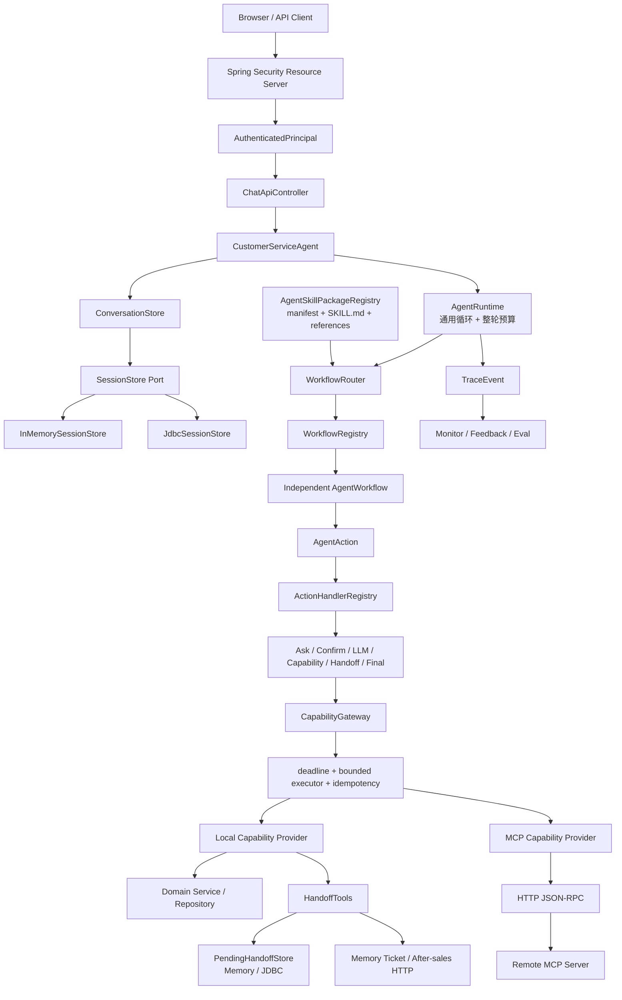
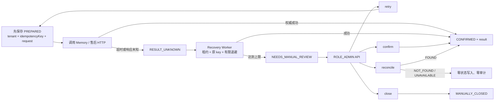

# Smart CS Agent 当前架构设计

> 更新日期：2026-07-14
> 代码基线：Phase 9.5，Legacy 执行链清理、Maven Modules 决策与最终验收已完成
> 阅读原则：本文描述当前代码已经实现的架构，不把后续规划写成既成事实。

## 1. 项目定位

Smart CS Agent 是一个面向电商客服的任务型 Agent。它不是把用户消息直接交给大模型，而是把一轮服务拆成：

1. 验证身份和资源归属；
2. 恢复已有多轮任务，或选择新的业务 Workflow；
3. 由 Workflow 决定下一步动作；
4. 由 Action Handler 执行动作；
5. 通过 Capability Gateway 调用本地能力或 MCP 远程能力；
6. 保存会话状态、幂等结果和人工转接 Outbox；
7. 用 Trace、Monitor 和 Eval 验证真实执行链路。

项目当前最重要的架构目标已经实现：

> 新增一个业务 Workflow 时，不修改 AgentRuntime、核心 Router 或 CapabilityGateway 的业务分支。

这不等于系统已经完全生产级。Phase 9 已删除 Legacy 执行链；单 Maven Module 是当前基于一个发布单元
作出的明确选择。按租户 LLM 隔离、多实例进程级压测等仍是后续工作。

## 2. 当前总体架构



这个图里有五条需要先记住的边界：

- `AgentRuntime` 只负责通用执行循环，不知道订单、退货或保修规则。
- `AgentWorkflow` 只决定下一步做什么，不直接访问 Repository 或 HTTP。
- `ActionHandler` 负责怎样执行某类动作，不决定完整业务状态机。
- `CapabilityGateway` 只处理能力契约、身份、预算、幂等和 Provider 分发。
- `Agent Skill Package` 提供说明、Prompt、references 和能力白名单，不替代 Java Workflow 状态机。

## 3. 每一层负责什么

| 层 | 当前主要对象 | 负责 | 不负责 |
| --- | --- | --- | --- |
| HTTP 与安全 | Controller、SecurityConfig、JwtPrincipalConverter | DTO、校验、JWT、RBAC、错误响应 | 不相信请求体自报身份 |
| Agent 入口 | CustomerServiceAgent | 组装一轮请求、会话和 Runtime | 不写具体业务规则 |
| 会话 | ConversationStore、SessionStore | 复合键、本地锁、快照、version CAS | 不执行副作用 |
| 执行内核 | AgentRuntime | Action 循环、步数、整轮 deadline、Trace、终止 | 不按业务写 switch |
| 路由 | WorkflowRouter、WorkflowRegistry | 恢复活跃 Workflow 或选择新 Workflow | 不调用业务工具 |
| 业务决策 | 8 个 AgentWorkflow | 槽位、状态机、确认、下一 Action | 不直接访问数据库或 HTTP |
| 动作执行 | 7 类 ActionHandler | 追问、确认、LLM、能力、转人工、结束 | 不拥有完整业务流程 |
| 能力内核 | CapabilityCatalog、Gateway | Schema、身份、allowlist、deadline、幂等 | 不理解对话状态 |
| 能力实现 | Local/MCP Provider | 适配领域服务或远程 MCP | 不决定多轮流程 |
| Skill Package | skills/* | 版本、说明、Prompt、references、能力白名单 | 不单独完成确定性状态机 |
| 人工转接 | Handoff、Outbox、Recovery、Review | 结果未知、有限恢复、人工处置、审计 | 不把未知伪造成成功 |
| 可观测性 | Trace、Monitor、Eval | 安全事件、指标、反馈和回归证据 | 不保存不必要的原始隐私 |

## 4. 项目里的 Skill 到底是什么

这个项目历史上有两种都叫 Skill 的东西，必须明确区分。

### 4.1 早期 Java Skill

`CustomerServiceSkill` 曾同时负责意图判断、槽位收集和动作编排。这更像一个代码内的业务决策器，
不是通常所说的声明式 Agent Skill。Phase 9 已删除该类与 Legacy Adapter；稳定 Workflow ID
`customer_service` 由 `GeneralCustomerServiceWorkflow` 继续承接闲聊和模糊诉求。

### 4.2 当前 Agent Skill Package

根目录每个 `skills/<skill-id>/` 包含：

```text
manifest.yaml
SKILL.md
prompts/
references/
```

运行时会真实加载并校验这些文件，记录 Skill ID 和版本，并用 manifest 中的 allowlist 限制该 Workflow 可以调用的 Capability。

当前更准确的术语关系是：

```text
Agent Skill Package = 业务说明 + Prompt + references + 权限清单
AgentWorkflow        = 可执行、多轮、确定性的业务状态机
Capability           = 有 Schema 和结果语义的原子业务能力
MCP                  = Capability 的一种远程发现、调用和暴露方式
AgentRuntime         = 与具体客服业务无关的通用执行内核
```

因此，当前 Skill Package 已接近一般所说的 Agent Skill，但本项目没有把高风险状态机完全交给 Markdown 或模型自由执行。退货确认、身份、并发和副作用仍由 Java Workflow 与 Gateway 约束。

## 5. 一轮聊天请求怎样执行

以用户发送“我要退货”为例：

1. Resource Server 校验 JWT 签名、issuer、audience、时间、subject、tenant 和角色。
2. `JwtPrincipalConverter` 生成可信 `AuthenticatedPrincipal`。
3. Controller 只从 Principal 取得 tenantId 和 userId，请求体不能覆盖身份。
4. `ConversationStore` 用 tenantId、userId、conversationId 组成完整会话键。
5. 同一实例先用本地锁串行化同一会话，再从 Memory/JDBC SessionStore 读取快照。
6. `AgentRuntime` 建立步数预算和 30 秒 wall-clock 总预算。
7. `WorkflowRouter` 优先恢复等待中的任务，否则给已注册 Workflow 评分。
8. `ReturnApplyWorkflow` 决定追问订单号、原因、确认，或发出 CapabilityAction。
9. `ActionHandlerRegistry` 找到对应 Handler。
10. Capability Handler 先检查当前 Skill allowlist，再构造可信 `ExecutionContext`。
11. Gateway 取整轮剩余时间与能力默认 deadline 的较早值。
12. 副作用能力在调用 Provider 前竞争幂等执行权；执行放入有界线程池。
13. Provider 返回 SUCCESS、BUSINESS_REJECTED 或 TECHNICAL_FAILURE。
14. Workflow 根据结构化 Observation 继续、等待、完成、取消或失败。
15. Runtime 写入安全 Trace 和最终回复。
16. ConversationStore 使用读取时的 expectedVersion 做 CAS 保存。
17. Controller 把 Turn 交给 Monitor 分类，并返回响应。

关键点是：Session CAS 保护状态更新，Capability 幂等保护副作用执行。两者解决的是不同问题，不能互相替代。

## 6. 当前可扩展点

### 6.1 新增业务 Workflow

以现有 `WarrantyQuery` 扩展证明为例：

1. 新增 Skill Package；
2. 新增实现 `AgentWorkflow` 的类；
3. 通过 Spring 组件扫描进入 `WorkflowRegistry`；
4. 如需私有状态升级，注册 `WorkflowStateMigrator`；
5. 增加路由、状态机和架构边界测试。

不需要修改 Runtime、Router 的业务分支或 Gateway。这里的“无需修改 Router”是指不增加 warranty 特判；新 Workflow 仍需提供自己的 descriptor 和 match 逻辑。

### 6.2 新增 Action

新增 `AgentAction` 与对应 `ActionHandler<T>`。Registry 按 Action 类型注册，Runtime 不增加 `instanceof` 链。

### 6.3 新增 Capability

1. 定义稳定 ID、输入/输出 Schema、身份要求、风险和幂等语义；
2. 新增 Local 或 MCP Provider；
3. 把 Capability 加入需要使用它的 Skill allowlist；
4. 使用契约测试验证三态结果、身份和副作用边界。

Workflow 只依赖 Capability ID 与结构化结果，不依赖具体 Java 方法或远端 URL。

### 6.4 替换本地能力为 MCP

`smartcs.capability.provider-mode` 支持 local、mcp-remote 和混合装配。MCP Client 使用服务端配置的 Bearer JWT；JSON-RPC body 中的普通 `_meta` 不能冒充最终用户。

### 6.5 增加售后查询 Adapter

`AfterSalesTicketResultLookup` 已定义 FOUND、NOT_FOUND、UNAVAILABLE 三态。当前外部售后平台没有只读幂等查询 API，所以默认 Adapter 明确返回 `QUERY_NOT_SUPPORTED`。未来只需增加 HTTP Adapter 并切换配置，不修改 ADMIN Controller、状态机或 Store。

## 7. 状态、并发与可靠性

### 7.1 会话状态

- 单实例：`ConversationStore` 对完整 ConversationKey 加本地锁。
- 多实例：`SessionStore` 使用 version CAS，旧版本不能覆盖新版本。
- Workflow 私有状态：带 schemaVersion，并通过注册式迁移链逐版本升级。
- 当前限制：物理删除后 version 重置，仍有 generation/ABA 风险。

### 7.2 Capability 副作用

- JDBC 幂等表使用唯一 key、owner token 和短租约竞争执行权。
- Owner 执行慢能力时续租，其他实例不能同时成为执行者。
- 完成结果可稳定回放，Session 保存失败后的重试不会重复调用已完成 Provider。
- 如果副作用已经开始但等待超时，返回 `CAPABILITY_RESULT_UNKNOWN`，不声称失败。
- Provider 已成功但结果尚未保存时仍有崩溃窗口，所以项目不宣称 exactly-once。

### 7.3 整轮与单次调用预算

- Agent 默认最多 10 个 Action。
- 一轮默认最多 30 秒，并在关键检查点停止继续规划。
- LLM 单次默认等待 12 秒，SDK 总尝试次数默认为 1。
- LLM 和 Capability 使用独立有界执行器，队列饱和时快速失败。
- Java 中断是协作式取消，仍不能替代客户端和下游自身的超时。

## 8. 人工转接可靠性闭环



这里有几个刻意的安全设计：

- `PendingHandoffKey` 同时包含 tenantId 和 idempotencyKey，所有单记录操作都不能只传裸 key。
- 调用外部平台前先持久化请求，缩小“远端可能成功但本地什么也没有”的窗口。
- 成功响应缺少 ID、状态或创建时间时 fail-closed，不生成 `AS-UNKNOWN` 或本机时间。
- Worker 只能有限恢复，达到上限后转人工，不无限重试。
- ADMIN 列表、详情、审计、retry、confirm、reconcile、close 都只使用 JWT 中的租户和 actor。
- Memory 与 JDBC Store 对 version、状态冲突、结果投影和审计保持一致。
- JDBC 人工处置在同一事务内更新主记录、成功结果和追加式审计。
- `reconcile` 只有权威 FOUND 才写入；“查不了”不能被当成“远端不存在”。

## 9. 安全边界

### 9.1 身份与角色

| 角色 | 主要权限 |
| --- | --- |
| CUSTOMER | Chat、自己的会话/长期记忆、提交反馈 |
| ADMIN | Monitor、Eval、Tool、PendingHandoff 复核与审计 |
| MCP_CLIENT | MCP REST 和 JSON-RPC 服务调用 |

未知路径默认拒绝。生产必须关闭 Demo token issuer，并接入真实身份系统。

### 9.2 租户与所有权

- Chat 会话使用 tenantId + userId + conversationId。
- PendingHandoff 使用 tenantId + idempotencyKey，管理查询使用 tenantId + outboxId。
- 售后 `X-Tenant-Id` 来自当前可信执行上下文。
- 跨租户不存在和本租户不存在使用同一种 404，避免资源枚举。

### 9.3 可观测数据

公开 Trace 会递归遮蔽敏感 key，限制字符串、集合、Map 和递归深度，并默认省略用户原话、Prompt、回复和异常原文。MCP 审计保留稳定 ID、结果、错误码和耗时，不记录凭据或完整参数。

## 10. 数据与部署模式

| 能力 | 默认模式 | 可替换模式 |
| --- | --- | --- |
| Session / Capability 幂等 / Handoff | memory | jdbc / MySQL |
| Capability Provider | local | mcp-remote / hybrid |
| RAG | local | embedding-qdrant |
| 人工转接创建 | memory | after-sales-http |
| 售后结果查询 | unavailable | 未来 http Adapter |

JDBC 当前共 10 张表：

- 4 张业务表：用户、商品、订单、退货；
- 1 张 Session 表；
- 1 张 Capability 幂等表；
- 4 张 PendingHandoff 表：主记录、成功结果、租约 Claim、人工处置审计。

Compose 默认启动 MySQL 8.4.0、Qdrant 和 Agent。Agent 容器默认使用 JDBC；宿主机端口可以通过 `SMARTCS_AGENT_PORT` 覆盖，容器内始终监听 8080。

## 11. 当前已经实现的功能

- 订单查询、订单列表、商品搜索与库存价格咨询；
- 多轮退货申请、确认、取消和退货进度查询；
- 政策 RAG、保修查询、用户资料和长期偏好；
- 9 个 Agent Skill Package 与 8 个独立业务 Workflow；
- Local/MCP Capability Provider、JSON-RPC MCP Server 与远程 Client；
- Memory/JDBC Session、业务数据、Capability 幂等和 Handoff 持久化；
- JWT/RBAC、租户隔离、资源所有权和 Trace 脱敏；
- LLM/Capability deadline、有界执行器和整轮 wall-clock 预算；
- 人工转接 Outbox、租约恢复、ADMIN 复核、追加式审计和三态结果查询 Port；
- Trace、Monitor、反馈候选、五类离线 Eval 和 GitHub Actions；
- Docker 多阶段镜像、Compose、liveness/readiness 和真实 MySQL 验收。

## 12. 当前不足

这些边界需要在简历和面试中主动说明：

1. 外部售后平台没有公开按 Idempotency-Key 的只读查询 API，当前 `reconcile` 默认安全返回 503。
2. 当前是单 Maven Module。依赖分析发现仍有核心上下文双向引用，且系统只有一个 JAR/镜像发布单元；
   当前用包边界测试约束，待 MCP Server 或 Agent Core 出现独立发布/复用需求后再拆。
3. 没有两个真实 Agent 进程同时恢复的故障注入和高并发压测。
4. JDBC 模式已迁移到 MyBatis XML Mapper、HikariCP 和 Spring 事务；Schema 仍由
   `CREATE TABLE IF NOT EXISTS` 初始化，尚未引入 Flyway/Liquibase 版本迁移。
5. 退货表缺少 orderId 唯一约束，业务编号生成方式不适合高并发。
6. LLM 执行器还缺 Micrometer 指标和按租户/模型 bulkhead。
7. RAG 和 Eval 数据集规模较小，离线通过不能代表真实线上准确率。
8. MCP 还没有签名用户委托和细粒度 scope。
9. 项目是工程化学习与作品集项目，不能宣称已经达到完整生产级。

## 13. 初学者推荐阅读顺序

1. `agent/action/AgentAction.java`：理解“下一步动作”的统一抽象。
2. `workflow/api/AgentWorkflow.java`：理解业务流程只做决策。
3. `workflow/returnapply/ReturnApplyWorkflow.java`：看完整多轮状态机。
4. `workflow/core/WorkflowRouter.java`：看活跃任务恢复和新任务路由。
5. `agent/AgentRuntime.java`：看通用循环、预算和 Trace。
6. `agent/handler/core/ActionHandlerRegistry.java`：看动作如何插件化。
7. `capability/core/DefaultCapabilityGateway.java`：看身份、deadline、幂等和 Provider 分发。
8. `skill/registry/AgentSkillPackageRegistry.java`：看 Skill Package 怎样真正进入运行时。
9. `session/api/SessionStore.java` 与两个实现：理解 Port/Adapter 和 CAS。
10. `handoff/outbox/PendingHandoffStore.java`：理解结果未知为什么需要持久化。
11. `handoff/admin/PendingHandoffAdminService.java`：看可信身份、复核和查询三态。
12. `mcp/server/McpServerAdapter.java`：看同一 Capability 如何通过 MCP 暴露。

阅读时对每个类问四个问题：

- 它依赖的是稳定接口还是具体实现？
- 它决定“做什么”还是执行“怎么做”？
- 身份和幂等键从哪里来，能否被客户端伪造？
- 失败时状态、结果和 Trace 分别怎样变化？

## 14. 面试表达

可以用下面这段概括架构：

> 我把客服 Agent 拆成 Skill Package、Workflow、Runtime、Action Handler 和 Capability 五个边界。Skill Package 保存说明、Prompt、references 和能力白名单；Workflow 负责确定性多轮状态机；Runtime 只执行通用循环；Handler 执行具体动作；Capability Gateway 统一身份、Schema、deadline、幂等和 Local/MCP Provider。会话状态用本地锁加 JDBC version CAS，副作用另用幂等租约和 Outbox。人工转接在外部调用前保存 PREPARED，结果未知时有限恢复，最终进入 ADMIN 复核和追加式审计，因此不会把超时或缺字段响应伪装成成功。

如果面试官问为什么没有立刻拆 Maven 多 Module：

> 我先用 package、SPI、Registry 和源码架构门禁稳定依赖方向。当前只有一个 JAR、一个镜像和一个发布
> 生命周期，直接拆 Module 还会遇到 agent、workflow、capability 上下文的双向依赖。等 MCP Server
> 需要独立部署，或 Agent Core 被第二个应用复用时再拆，收益才大于构建成本。

## 15. 结论

项目已经从早期“大 Skill + ToolManager”的客服 Demo，演进成注册式 Workflow、插件式 Action Handler、
统一 Capability 契约和可替换 Adapter 的架构。Phase 9 已物理删除旧 Skill/Tool 双轨执行链，并用 7 个
独立 Local Provider 覆盖 9 个能力。默认测试、真实 MySQL、JAR 和 Docker/Compose 最终验收已经完成，
当前重点转向连接池、数据库迁移、多实例故障注入和集中安全审计等生产化约束，而不是继续维护迁移兼容层。

最核心的工程原则是：

> 不让模型自由决定高风险事实，不把未知伪装成失败或成功，并让每个扩展点都能通过稳定接口和自动化证据验证。
