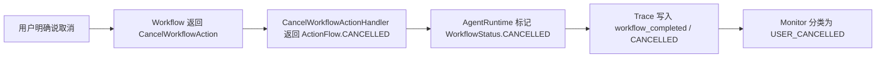

# 客服 Agent Monitor 统一 Turn 结果与异常指标说明

## 1. 本批解决什么问题

旧 Monitor 主要统计工具调用、LLM 调用和人工转接次数，但“一轮对话最终为什么结束”没有统一答案。
例如下面几种情况都会表现成某种 `success=false`，却需要完全不同的处理方式：

- 订单不存在：系统正常工作，只是业务条件不满足；
- 数据库不可用：系统技术故障，需要运维告警；
- 查询了其他用户的订单：安全边界拒绝，需要安全审计；
- 用户主动说“取消”：正常终止，不应触发故障告警。

如果只保留一个 failed 数字，业务、运维和安全人员都无法准确判断问题。本批因此为每个 Agent Turn
增加唯一结果分类，并补齐“尚未生成 ChatResponse 就抛异常”的统计盲区。

## 2. 五类互斥结果

| TurnOutcome | 含义 | 典型例子 | 是否表示系统故障 |
| --- | --- | --- | --- |
| `SUCCESS` | 正常完成、正常追问或成功转人工 | 查询成功、等待订单号、创建人工工单 | 否 |
| `BUSINESS_REJECTED` | 系统正常，但业务条件不满足 | 订单不存在、当前状态不允许操作 | 否 |
| `TECHNICAL_FAILURE` | 依赖或代码执行失败 | LLM 失败、Provider 异常、Session 版本冲突 | 是 |
| `GUARDRAIL_REJECTED` | 身份、权限或能力白名单拒绝 | 订单归属不符、Capability 未授权 | 否，但应审计 |
| `USER_CANCELLED` | 用户主动取消当前任务 | 等待订单号时回复“取消” | 否 |

所有结果计数之和必须等于 `totalTurns`。`turnSuccessRate` 只使用 `SUCCESS / totalTurns`，不会把业务拒绝、
Guardrail 或取消混入成功率。

## 3. 为什么从 Trace 分类

分类入口是 `TurnOutcomeClassifier`，它只读取事件名和结构化字段：

- `outcome`；
- `errorCode`；
- Workflow 的 `status` 或 `statusAfter`；
- `tool_failed`、`llm_failed`、`action_handler_failed` 等稳定事件名。

它不会读取 `ChatResponse.reply`。原因是自然语言会变化，也可能由模型生成；用“回复里是否包含失败、取消”
做判断既不稳定，也容易受提示词或语言切换影响。

一轮 Trace 可能同时出现多个结果。例如 Capability 白名单拒绝后，兼容层还可能产生一条技术失败事件。
分类器使用以下固定优先级选出唯一结果：

```text
GUARDRAIL_REJECTED
    > TECHNICAL_FAILURE
    > USER_CANCELLED
    > BUSINESS_REJECTED
    > SUCCESS
```

旧 `CapabilityOutcome` 暂时只有 `BUSINESS_REJECTED`，所以迁移期会用通用错误码词义识别安全拒绝，例如
`AUTHENTICATION`、`AUTHORIZATION`、`OWNERSHIP`、`ACCESS_DENIED`、`NOT_ALLOWED` 和
`DELEGATION`。这里故意不写 `ORDER_*`、`RETURN_*` 等领域分支，避免 Monitor 重新变成业务大类。

## 4. 用户取消为什么需要新 Action

此前多个 Workflow 只把自己的私有步骤改成 `CANCELLED`，但 `AgentRuntime` 执行的仍是普通
`FinalAnswerAction`。Handler 返回 `COMPLETED` 后，全局 Workflow 状态会被写成 `COMPLETED`，Monitor
看不到真正的取消原因。

现在取消是结构化控制流：



这样 Runtime 只认识通用 `ActionFlow`，不需要知道订单、退货或商品 Workflow 的内部步骤。人工转接仍返回
`HANDED_OFF`，因此“用户取消”和“成功交给人工”不会混在一起。

## 5. ChatResponse 之前抛异常怎么办

Trace 只能随 `ChatResponse` 返回。如果 Agent 在保存 Session、获取锁或执行入口逻辑时直接抛异常，原来
Monitor 完全看不到这一轮。

`ChatApiController` 现在在进入 `agent.chatWithTrace()` 前开始计时，并在异常边界调用
`MonitorService.recordFailedTurn(...)`：

| 异常 | TurnOutcome | Monitor errorCode |
| --- | --- | --- |
| `AuthenticationException` | `GUARDRAIL_REJECTED` | 异常提供的稳定码 |
| `AuthorizationException` | `GUARDRAIL_REJECTED` | `ACCESS_DENIED` |
| `SessionVersionConflictException` | `TECHNICAL_FAILURE` | `SESSION_VERSION_CONFLICT` |
| 其他 `RuntimeException` | `TECHNICAL_FAILURE` | `CHAT_TURN_EXECUTION_FAILED` |

记录后仍重新抛出原异常，由原有 `GlobalExceptionHandler` 决定 HTTP 状态和对外安全文案。Monitor 只保存稳定
错误码，不接收异常 message、数据库错误详情或堆栈。监控写入本身也有独立异常边界：即使未来外部指标
后端不可用，成功聊天不会被改成 HTTP 500，原始 Agent 异常也不会被 Monitor 异常覆盖。旁路失败日志只
记录操作名和异常类型，不记录异常 message 或堆栈。

## 6. Monitor API 和前端新增字段

`MonitorSummary` 新增：

- `successfulTurnCount`；
- `businessRejectedTurnCount`；
- `technicalFailureTurnCount`；
- `guardrailRejectedTurnCount`；
- `userCancelledTurnCount`；
- `turnSuccessRate`。

`MonitorTurnSnapshot` 新增 `outcome` 和 `errorCode`。`totalDurationMs` 在 HTTP Chat 路径表示完整 Agent Turn
耗时；旧内部调用没有端到端计时时，才回退为工具耗时与 LLM 耗时之和。

前端 Monitor 面板展示五类计数、成功率和最近 Turn 结果。`conversationId`、`userId`、`outcome`、
`errorCode` 和时间文本在写入 `innerHTML` 前都经过 `escapeHtml`；Badge CSS 类只由固定相等判断产生，
不会把服务端字符串直接拼进 class 属性。

## 7. 扩展新错误时怎么做

新增 Capability 或 Workflow 时遵循以下规则：

1. Provider 返回稳定 `outcome` 和 `errorCode`，不要让 Monitor 解析用户回复。
2. 用户主动取消时返回 `CancelWorkflowAction`，不要用普通 `FinalAnswerAction` 假装完成。
3. 新的技术失败应写结构化失败 Trace；异常 message 只用于受控内部日志，不能进入公开 Trace。
4. 新错误码若属于通用安全语义，可以扩展 `isGuardrailErrorCode`；不要添加具体业务 ID 判断。
5. 若未来给 `CapabilityOutcome` 增加原生 `GUARDRAIL_REJECTED`，应删除对应的迁移兼容判断。

## 8. 测试覆盖

本批测试分四层：

- 分类器单元测试：空 Trace、旧安全错误码、跨事件优先级；
- Monitor 聚合测试：五个互斥计数、成功率、最近 Turn 和异常前置记录；
- Controller/MVC 测试：原异常重新抛出、HTTP 500 安全文案和失败指标；
- 真实 Agent 集成测试：订单不存在、订单归属不符、真实多轮取消，以及成功转人工不误判为取消。

默认 `mvn test` 共执行 `355` 项测试，0 失败、0 错误、0 跳过。

## 9. 当前边界与下一步

- Monitor 仍是单 JVM 内存聚合，应用重启会清零，多实例之间也不会自动汇总；
- 还没有接入 Micrometer、Prometheus Histogram 或按租户隔离的外部指标系统；
- Spring Security Filter、JSON 解析和 Bean Validation 在进入 Agent 前拒绝的请求不属于 Agent Turn，后续应由
  HTTP/安全指标单独统计；
- 当前错误码安全词义识别是迁移策略，不是最终 Capability 契约；
- 数据库掉线、网络超时、租约失效、熔断和进程重启仍需要后续故障注入测试。

因此，本批完成的是“结果语义和异常指标不再缺失”，不是完整的生产监控平台。
