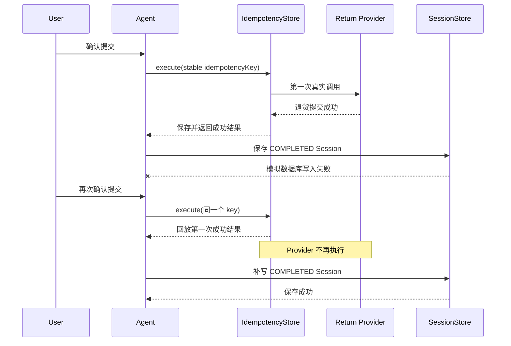

# 客服 Agent 失败生命周期与可靠性故障注入说明

## 1. 为什么需要这一批

前几批已经分别实现了 Session CAS、Capability 幂等、JDBC 超时、MCP 重试/熔断和 Monitor 技术失败，
但“某一层有代码”不等于“整条链在故障时仍然正确”。本批先审计组合行为，再补最容易造成数据错误或
假成功的缺口。

审计发现四个可以在当前边界内安全修复的问题：

1. 未知 Action Handler 异常返回普通 `COMPLETED`，Workflow 生命周期与技术失败 Trace 冲突；
2. Agent 最大 10 步写死，无法配置，也没有真正触发超限的测试；
3. `JdbcSessionStore` 在 owner 校验前执行 SQL，错误快照可能先污染数据库；
4. MCP HTTP 200 空结果会被映射成成功，熔断器只测试了打开，没有测试冷却恢复。

## 2. FAILED 是独立的 Workflow 终态

`ActionFlow` 现在包含 `FAILED`。Runtime 的未知 Handler 异常边界会返回安全回复和
`ActionExecutionResult.failed(...)`，随后统一完成三件事：

- `ConversationState` 标记为 `WorkflowStatus.FAILED`；
- Trace 写入 `action_handler_failed` 和 `workflow_completed / FAILED`；
- 当前 Turn 结束，下一轮 Router 不恢复这个终态 Workflow。

这和 LLM Handler 自己理解并处理的降级不同。一个 Handler 可以明确返回可用降级结果；但 Runtime 捕获到
的未知插件异常表示执行契约已经破坏，不能假装任务正常完成。

## 3. Agent 步数预算

配置项：

```yaml
smartcs:
  agent:
    max-iterations: ${SMARTCS_AGENT_MAX_ITERATIONS:10}
```

它限制的是一轮最多执行多少个 Action，不是秒数。配置必须大于 0，不能通过写 0 关闭保护。

测试用一个始终返回 `CONTINUE` 的扩展 Skill/Handler 触发预算，验证：

- Runtime 在配置的第 3 步后停止；
- 用户收到安全暂停回复；
- Workflow 状态为 `FAILED`；
- Trace 同时有 `turn_timeout` 和 `workflow_completed / FAILED`；
- Monitor 结果为 `TECHNICAL_FAILURE`，错误码是 `TURN_STEP_BUDGET_EXCEEDED`。

## 4. JDBC Session owner 必须写前校验

`SessionRecord` 构造器原本会检查 `key.userId == snapshot.userId`，但它在 SQL 成功后才创建。如果调用方直接
使用 `SessionStore` SPI，错误流程是：

```text
INSERT/UPDATE 已成功 -> 构造 SessionRecord -> owner 校验抛异常
```

调用方以为保存失败，数据库却已经被错误 owner 污染。现在 `JdbcSessionStore.save()` 在 JSON 编码和任何
SQL 前完成 null、版本和 owner 校验。测试替身会检查内部 rows，证明异常返回后没有任何 Session 行写入。

## 5. Session 保存失败后的副作用回放

最危险的故障不是 Provider 直接失败，而是 Provider 已成功后 Session 保存失败：



真实 Spring Agent 集成测试使用失败一次的 SessionStore 包装器和 Spy Provider，证明第一次失败后 Session
仍停在原版本，第二次 Trace 带 `replayed=true`，而退货 Provider 的总调用次数始终为 1。

## 6. MCP 协议、重试与熔断

### 6.1 HTTP 200 不等于业务成功

Transport 现在先校验 JSON-RPC envelope：

- `jsonrpc` 必须为 `2.0`；
- 必须存在响应 `id`；
- `result` 和 `error` 必须且只能出现一个。

再按方法校验结果：

- `initialize` 需要 `protocolVersion` 和 `serverInfo`；
- `tools/list` 需要 tools 集合；
- `tools/call` 需要 content 集合，`isError` 存在时必须是 boolean。

这些校验位于重试闭包内，所以协议错误会进入稳定错误和熔断计数，不会继续映射为空成功结果。

### 6.2 哪些错误重试

- 网络连接/读取异常：有限重试；
- HTTP 5xx：有限重试；
- HTTP 408、429：有限重试；
- HTTP 401/403 等确定性 4xx：不重试；
- JSON-RPC error 或协议结构错误：不重试。

当前还没有退避和抖动，后续若接高流量远端 MCP，应在剩余 deadline 内加入 bounded backoff。

### 6.3 冷却后恢复

Transport 支持注入测试时钟。测试先用 500 打开熔断，然后推进时钟跨过冷却窗口，再返回合法 initialize
响应，验证请求恢复、`consecutiveFailures` 清零、`lastError` 清空。另一个本地 JDK HTTP Server 故意延迟
响应，证明配置的 read timeout 会在上限内终止等待。

## 7. 本批与已有测试的组合证据

| 场景 | 证据 |
| --- | --- |
| 同进程同会话并发 | `ConversationStoreSafetyTest` |
| 两个 Store 同 revision 写入 | `SessionStorePersistenceTest` |
| Workflow 重建恢复 | `SessionRecoveryWorkflowIntegrationTest` |
| JDBC 幂等抢占、租约、续租和回放 | `JdbcCapabilityIdempotencyStoreTest` |
| Session 保存失败后的副作用回放 | `SessionSaveFailureRecoveryIntegrationTest` |
| Handler 未知异常进入 FAILED | `ActionHandlerRegistryTest` |
| Agent 循环超限 | `AgentRuntimeResilienceTest` |
| MCP 慢响应、协议错误、重试和熔断恢复 | `HttpMcpClientTransportTest` |
| Provider 异常安全归一化 | `DefaultCapabilityGatewayTest` |
| JDBC owner 失败零写入 | `JdbcSessionStoreTest` |

默认 `mvn test` 共执行 `364` 项测试，0 失败、0 错误、0 跳过。

## 8. 仍未完成的生产可靠性

本批不能解决以下问题，因此 Phase 8 总故障测试项仍未勾选：

- `CapabilityDefinition.defaultTimeoutMs` 尚未真正约束 Provider 执行时间；当前只检查调用前已过期；
- 不能用 `Future.cancel()` 强制声明副作用超时，因为底层写入可能仍在继续；应先完成 deadline 传播、
  “结果未知”语义、下游幂等/唯一约束或 Outbox；
- LLM 60 秒超时叠加默认重试可能长时间占用会话锁；
- 售后平台、Embedding 和 Qdrant HTTP Client 还没有显式 connect/read timeout；
- 售后平台失败时生成的 pending 人工工单没有可靠持久化，当前可能形成假成功；
- Session 物理删除仍存在 generation/ABA 风险；
- JDBC 退货表缺少 `order_id` 唯一约束，`COUNT(*) + 1` 也不是可靠的跨实例 ID；
- 默认测试使用内存/SQL 替身，还没有真实 MySQL、网络中断和容器重启验证。

这些问题应继续拆成独立批次，避免用一个“综合测试通过”掩盖边界仍然不完整。
